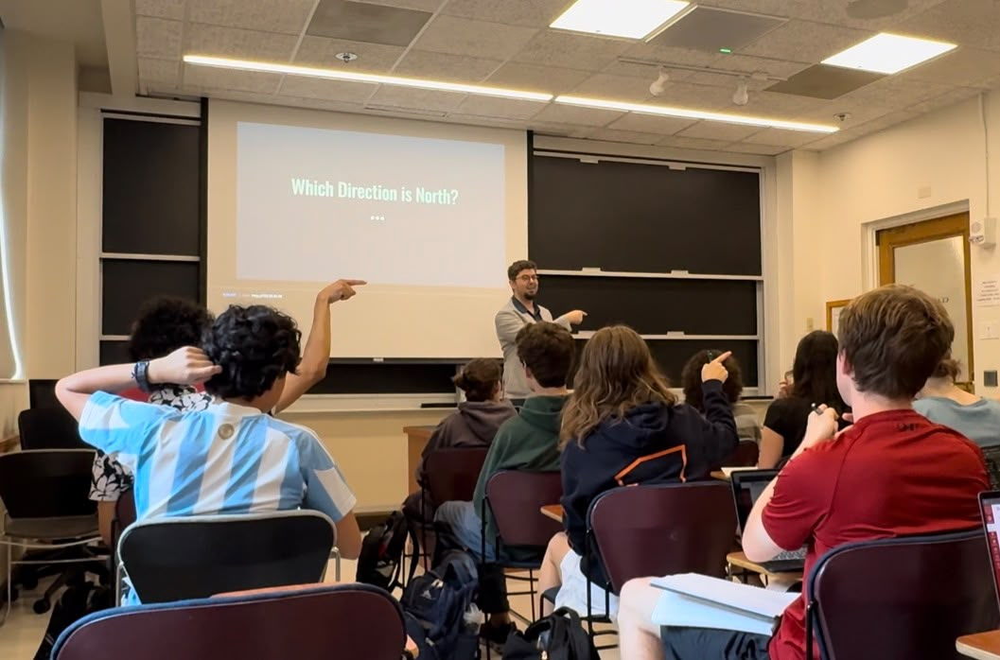

## Instructor of Record
- **Numerical Analysis in Astronomy I**, Ankara University — *Fall 2023*
- **Numerical Analysis in Astronomy II**, Ankara University — *Spring 2023, 2024*  
  Python-based numerical methods for astronomy, from introductory programming to research-grade scientific tools.

## Teaching Assistant
*2015–2024 (excluding Fall 2018 and Spring 2019)*
- Numerical Analysis in Astronomy I, Ankara University — *Fall 2016–2022*
- Numerical Analysis in Astronomy II, Ankara University — *Spring 2015–2022*
- Practical Astronomy, Ankara University — *Spring 2018–2024*
- Observational Astronomy, Ankara University — *Spring 2015–2018, 2020*

## Guest Lecturer
- Ampersand: Gateway Expeditions Into Exoplanets, Department of Physics, Washington University — *2024, 2025*
- Observational Instruments, Ankara University — *2016*

{: .outreach-photo style="max-width: 550px"}

## Observatory Instructor
*2015–2022 (excluding Fall 2018 and Spring 2019)*
- Conducted regular scientific observations and provided hands-on training in photometric and spectroscopic observing techniques for undergraduate and graduate students.
- Reinforced classroom instruction, mentored students in observational astronomy, and provided individualized academic and technical guidance.

## Curriculum and Educational Development
- **[ExoCore Open Science Curriculum](https://github.com/AstroMusers/ExoCore)** (NASA's Transform to Open Science) — *2025*
  Developed interactive Jupyter-based modules on celestial dynamics for an open-access curriculum that lowers the entry barrier to exoplanet research for students and early-career researchers.
- **Curriculum Development and Revision Committee**, Ankara University — *2018*  
  Contributed the computational and statistical methods component to the undergraduate curriculum revision.

## Research Mentoring

I have mentored 16 students, from undergraduate to PhD level, at five institutions: the University of Kansas, Washington University in St. Louis, Ankara University, Çukurova University and the University of Zanjan. This work has led to 12 student-led papers (2 under review), and I have continued mentoring several of these students through their own PhD research.

Student-led papers: Al Zaman et al. (2026, AJ, in press); [Temelci et al. (2026, NewA)](/publication/2026newa-12502533t/); [Akar et al. (2025, CoSka)](/publication/2025coska-55c-286a/); [Sertkan et al. (2025, CoSka)](/publication/2025coska-55c-301s/); [Güler et al. (2025, CoSka)](/publication/2025coska-55c-466g/); [Yalçınkaya et al. (2024a, MNRAS)](/publication/2024mnras-530-2475y/); [Yalçınkaya et al. (2024b, CoSka)](/publication/2024coska-54b-22y/); [Demir et al. (2023, TJAA)](/publication/2023tjaa-4s-401d/); [Aladağ et al. (2021, TJAA)](/publication/2021tjaa-2-28a/); [Davoudi et al. (2021, AJ)](/publication/2021aj-162-210d/).
